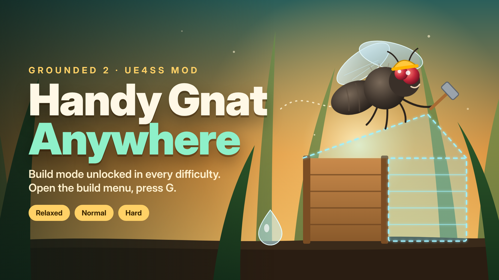

<p align="center">
  
</p>

# Handy Gnat Anywhere — Grounded 2

Unlocks the **Handy Gnat** (build mode) in **every difficulty** of Grounded 2, not only in Creative.
Open the build menu, press **G**, and build with the Gnat in Relaxed, Normal or Hard worlds.

> 🇧🇷 [Leia em português](#português)

## Features

- Handy Gnat available in Relaxed, Normal and Hard.
- Changes **only** that permission: difficulty, survival stats, damage and achievements stay as they are.
- Runtime UE4SS Lua mod: **no game files are replaced**, so game updates that reorder the
  preset options don't break it (unlike the older `.pak` approach).
- Optional hotkeys: `Ctrl+F7` re-apply · `Ctrl+F6` free camera (spectator mode).
- Lightweight: no scan of the game's objects — about 0.1 s once when you enter a world.

## Requirements

- Grounded 2 (Steam)
- [UE4SS for Grounded 2](https://www.nexusmods.com/grounded2/mods/259)

## Installation

1. Install **UE4SS for Grounded 2** into
   `...\steamapps\common\Grounded2\Augusta\Binaries\Win64\`
2. Copy the `HandyGnatAnywhere` folder into
   `...\Grounded2\Augusta\Binaries\Win64\ue4ss\Mods\`
   (it already contains `enabled.txt`, no need to edit `mods.txt`).
3. Remove any old Handy Gnat `.pak/.ucas/.utoc` mod from `Augusta\Content\Paks`.

## Usage

Enter your world, wait a few seconds, open the build menu and press **G**.
If the Gnat doesn't show up, press **Ctrl+F7** and try again. As a last resort, **Ctrl+Shift+F7**
runs a full scan (the game freezes for a few seconds) and remembers what it finds.

In multiplayer, the **host** should have the mod installed.

## Configuration

The top of `HandyGnatAnywhere/Scripts/main.lua` has a `Config` section. You can force other
preset options the same way, for example:

```lua
Options = {
    bBuildModeAvailable    = true,
    bAutoCompleteBuildings = true, -- instant building
},
```

## How it works

Grounded 2 keeps the Handy Gnat permission in the `bBuildModeAvailable` option of the game mode
presets (`SurvivalGameModeSettings`), which is only `true` in the Creative presets.
The mod sets it to `true` by name on the Relaxed/Normal/Hard presets and on any copy already loaded
in the world.

## Troubleshooting

Check `...\Win64\ue4ss\UE4SS.log` for lines starting with `[HandyGnatAnywhere]` and open an issue
with the log attached.

## Uninstall

Delete the `ue4ss\Mods\HandyGnatAnywhere` folder.

## Credits

- Inspired by the original Handy Gnat `.pak` mod on
  [Nexus Mods (Grounded 2 #212)](https://www.nexusmods.com/grounded2/mods/212). This is an independent
  rewrite; no files from that mod are included.
- [UE4SS](https://github.com/UE4SS-RE/RE-UE4SS) team.

Not affiliated with Obsidian Entertainment, Xbox Game Studios or Microsoft.

---

## Português

Libera a **Mosca Útil** (modo de construção) em **todas as dificuldades** do Grounded 2, não só no Criativo.
Abra a construção, aperte **G** e construa com a Mosca nos mundos Relaxado, Normal ou Difícil.

**Requisitos:** Grounded 2 (Steam) e [UE4SS for Grounded 2](https://www.nexusmods.com/grounded2/mods/259).

**Instalação**
1. Instale o **UE4SS for Grounded 2** em `...\steamapps\common\Grounded2\Augusta\Binaries\Win64\`.
2. Copie a pasta `HandyGnatAnywhere` para `...\Win64\ue4ss\Mods\` (já vem com `enabled.txt`).
3. Remova mods antigos da Mosca em `.pak` da pasta `Augusta\Content\Paks`.

**Uso:** entre no mundo, espere alguns segundos, abra a construção e aperte **G**.
Se não aparecer, aperte **Ctrl+F7** e tente de novo. `Ctrl+F6` liga a câmera livre (opcional).
No multiplayer, quem hospeda o mundo precisa ter o mod.

Altera **somente** essa permissão: dificuldade, fome, dano e conquistas continuam iguais.

## License

[MIT](LICENSE)
